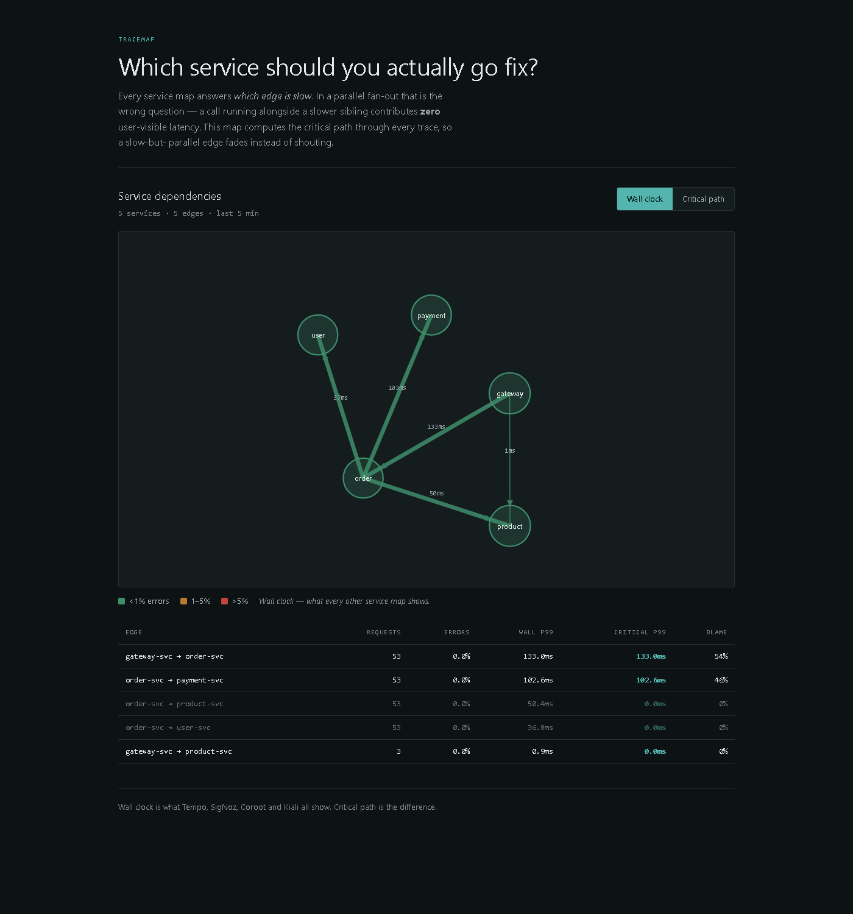
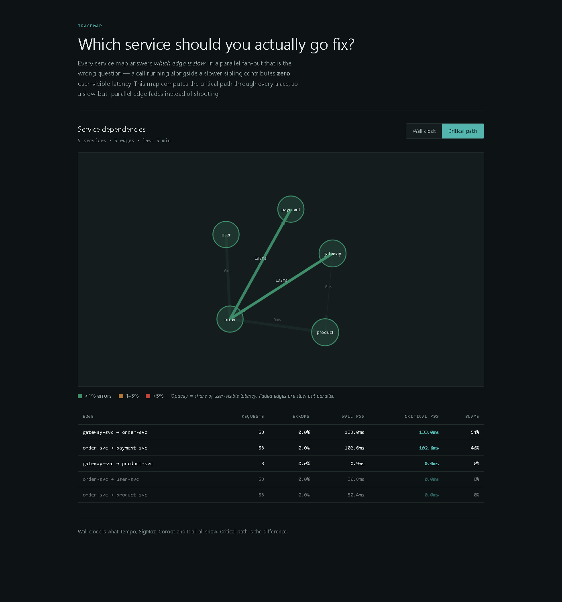
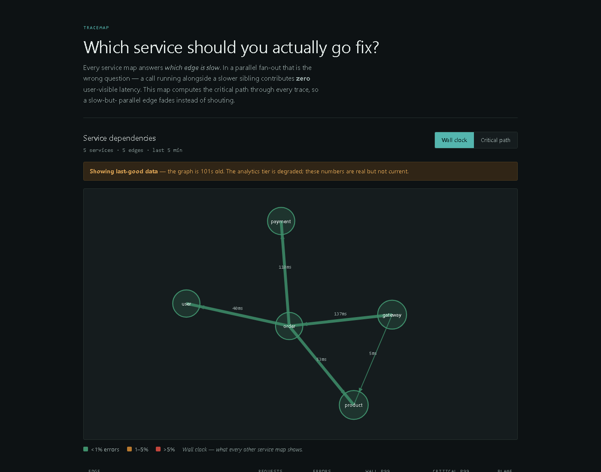
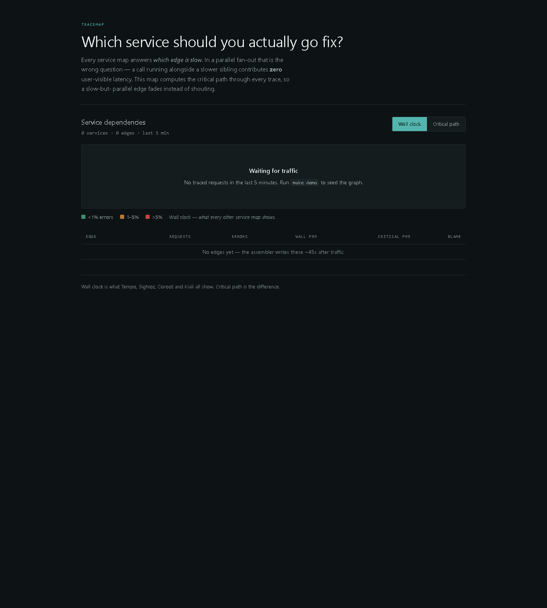

# TraceMap

**A dependency map that tells you which service to actually go fix.**

Every service map answers *which edge is slow*. In a parallel fan-out that is
the wrong question — a 700 ms call running alongside a 720 ms sibling
contributes **zero** milliseconds of user-visible latency, but Tempo's service
graph, SigNoz, Coroot and Kiali will all paint it red and send you to debug the
wrong service. TraceMap computes the **critical path** through every trace and
attributes user-visible milliseconds per edge, so the map is actionable rather
than merely informative.

```
order-svc            |------------------------------------- 730ms --|
  |- user-svc        |-- 40ms --|                             0.0 ms blame
  |- product-svc     |-------------------- 700ms ---------|   0.0 ms blame
  |- payment-svc     |---------------------- 720ms ---------| 720.0 ms blame
```

Making `product-svc` infinitely fast would save the user nothing.

That single idea runs all the way down: the detector alerts on critical-path
p99 rather than wall clock, the SLOs denominate error budgets in critical-path
milliseconds, and the eval set contains a case that a wall-clock detector fails
by design.

> **Status — Phase 8 of 8.** Everything above works and is verified against a
> running stack: five traced services → OpenTelemetry collector → Jaeger v2.20
> and ClickHouse 26.3 → critical-path assembler → dependency map, anomaly
> detector, deploy attribution, a twelve-case eval harness, per-edge SLOs and a
> cost meter.
>
> Three things are honestly open, and each links to where it is written up:
> the **eval gate is currently red** (precision 0.583 against a 0.870 floor —
> [`docs/EVAL.md §9`](docs/EVAL.md) has the run, the diagnosis and why the fix
> is not to move the floor); the **live URL is not deployed**; and the **demo
> video is not recorded** ([`docs/DEMO.md`](docs/DEMO.md) is the script it
> follows). Forty-one defects are logged in
> [`IMPLEMENTATION_PLAN.md`](IMPLEMENTATION_PLAN.md), three of them found in
> Phase 8 by running the system rather than reading it.

---

## Quick start

```bash
make demo
```

That boots the stack, seeds 60 seconds of traffic and prints the URLs. A demo
that opens on an empty graph is a demo you have already lost, so the seeding is
not optional and not a separate step.

| | |
|---|---|
| **http://localhost:3002** | the dependency map — flip the metric toggle |
| http://localhost:16686 | Jaeger, for the trace waterfall |
| http://localhost:8090/api/graph | the raw graph payload |
| http://localhost:8090/api/slo | error budgets on critical-path latency |
| http://localhost:8090/api/cost | what this is costing, from `system.parts` |

`make` on its own lists every target. `make monitoring` adds Prometheus and
Grafana — they are deliberately *not* in the core profile; see below.

<details><summary>This was tested from an actual clean clone, not assumed</summary>

`git clone` into an empty directory, `make env`, then a `--no-cache` rebuild of
every image and a boot onto **fresh volumes** under a separate compose project —
so nothing was inherited from the development machine:

- 16 containers healthy
- ClickHouse `docker-entrypoint-initdb.d` applied all eight schema files,
  including the newest — `edge_slo_1m` and its materialised view exist on a
  volume that has never seen a manual migration
- `./scripts/smoke-test.sh` → **SMOKE PASS**, one request through all five
  services
- 100 s of k6 traffic → a populated graph with `order-svc → user-svc` at
  **58.98 ms wall clock and 0.0 ms critical**

The one thing this does *not* prove is the letter of the exit criterion, which
says "on a machine that is not yours". Fresh clone, fresh volumes and
`--no-cache` images remove most of what that is guarding against, but not a
different OS or a different CPU architecture. Stated rather than glossed.

</details>

**Cost to run: €7.05/month.** One Hetzner CX32, measured rather than estimated —
[`docs/COST.md`](docs/COST.md) shows the working, including the 56 bytes on disk
per span it is derived from.

### Live URL

Not yet deployed. The pipeline is written and gated
([`.github/workflows/deploy.yml`](.github/workflows/deploy.yml)): it deploys to a
k3s node on a version tag, then asserts the public URL actually serves a graph
over HTTPS and that the write endpoints reject unauthenticated calls. It needs a
`TRACEMAP_HOST` repository variable and a tag push. Until both exist, this line
says "not yet deployed" rather than pointing at something that does not answer.

---

## The claim, as a test

The flagship is one function and it is specified by six tests written before the
worker that uses them. This is the first:

```javascript
// microservices/order/test/fanout.test.js
test('fan-out is concurrent, not sequential', async () => {
  const t0 = Date.now();
  const res = await createOrder(INPUT);
  const elapsed = Date.now() - t0;

  // Sequential would be >= 30 + 45 + 90 = 165ms of downstream time.
  assert.ok(elapsed < 150,
    `fan-out took ${elapsed}ms; sequential would be >=${SEQUENTIAL_MS}ms. ` +
    'The fan-out has regressed to sequential awaits (M1).');
});
```

```python
# platform/tests/test_critical_path.py  — THIS FILE IS THE SPECIFICATION
def test_parallel_fanout_blames_only_the_slowest_sibling():
    spans = [
        Span("root", "",     "gateway-svc", "POST /checkout", 0,       750 * MS),
        Span("ord",  "root", "order-svc",   "createOrder",    5  * MS, 740 * MS),
        Span("usr",  "ord",  "user-svc",    "getUser",        10 * MS,  50 * MS),
        Span("prd",  "ord",  "product-svc", "checkStock",     10 * MS, 710 * MS),
        Span("pay",  "ord",  "payment-svc", "charge",         10 * MS, 730 * MS),
    ]
    edges = attribute_to_edges(spans, compute_critical_path(spans))

    assert edges[("order-svc", "payment-svc")] == 720.0   # 100% of the blame
    assert edges[("order-svc", "product-svc")] == 0.0     # 700ms wall -> 0ms
    assert edges[("order-svc", "user-svc")]    == 0.0
    assert edges[("gateway-svc", "order-svc")] == 735.0   # order's whole subtree

    # M5: the zero-blame edges must be PRESENT, not missing. A dropped key makes
    # the edge vanish from the map instead of fading, and vanishing is a lie:
    # the call really happened.
    assert ("order-svc", "product-svc") in edges
```

Both are exit criteria, and both are enforced twice — in code and against the
live system:

```bash
make fanout-guard         # unit level: the orchestration is concurrent
make trace-guard          # system level: it survived the network and the collector
make critical-path-guard  # the flagship, against a running stack
make guards               # all of them
```

`M1` is one careless refactor away — a "simplify the async code" commit turns
`Promise.all` into sequential awaits, every edge lands on the critical path, and
the project's whole differentiator quietly stops having anything to show. Nothing
would fail. That is why it is asserted rather than noted.

---

## The toggle, on real traffic

Same five services, same five-minute window, one click apart.

**Wall clock** — what Tempo, SigNoz, Coroot and Kiali all show:



**Critical path** — `?metric=critical`:



`order-svc → product-svc` carries **50.4 ms of wall clock and 0.0 ms of blame**.
In the second view its edge fades to near-invisible and it drops to the bottom
of the table, because those 50 ms ran alongside a slower `payment-svc` and cost
the user nothing. `order-svc → user-svc` does the same at 36.8 ms.

The metric mode is in the URL on purpose. The point of this dashboard is to hand
someone the edge they should go fix, and a view you cannot link to is a view you
have to describe over a call.

<details><summary>Two states worth showing that are not the happy path</summary>

**Degraded.** ClickHouse stopped, 101 seconds into the outage — past the point
where this endpoint used to return HTTP 500 (F40). The graph is still there, the
numbers are still real, and the banner says exactly how old they are:



> *Showing last-good data — the graph is 101s old. The analytics tier is
> degraded; these numbers are real but not current.*

Silently stale numbers are worse than none (M26). Refusing to serve them at all
is worse still — it takes the last known shape of the system away from an
operator at the moment they most want it.

**Empty.** Before any traffic. It names the command to run rather than showing a
blank canvas — the state a first-time reader is most likely to hit.



</details>

---

## Architecture

```
5 services ──► OTel Collector (agent → gateway, tail sampling)
                   ├─► Jaeger v2.20  (search, waterfall UI)
                   └─► ClickHouse 26.3  tracemap.spans
                             │
                     trace-assembler ── stitch edges + critical path, one pass
                             ▼
             trace_edges · trace_critical_path
                             ▼
              service_edges_1m  (incremental MV, TDigest)
              edge_slo_1m       (latency histogram, per-edge error budgets)
              …_recon           (refreshable MV, correctness guard)
                             ▼
              FastAPI analytics API ──► Next.js dependency map
                             │
                       anomaly-detector ──► Slack, with a deploy correlation
```

The traced application is five services in three languages:

| Service | Language | Role | Baseline |
|---|---|---|---|
| `gateway-svc` | Node.js 24 / Express | Entry point, graceful degradation | 3–8 ms own work |
| `order-svc` | Node.js 24 / Express | **The concurrent fan-out** | 10–20 ms own work |
| `user-svc` | Python 3.14 / FastAPI | Profile lookup | 30 ms |
| `product-svc` | Go 1.26 / Gin | Stock check, deliberate N+1 | 45 ms |
| `payment-svc` | Python 3.14 / FastAPI | Charge — slowest by design | 90 ms |

```
client ──► gateway-svc ──► order-svc
                               │
                 ┌─────────────┼─────────────┐   ← CONCURRENT. This is the point.
                 ▼             ▼             ▼
             user-svc     product-svc   payment-svc
                 └─────────────┼─────────────┘
                               ▼
                        PostgreSQL 18
```

Three languages is deliberate: it proves OpenTelemetry is not a one-language
trick, and it forces confronting that **Go has no runtime auto-instrumentation
agent**. Go compiles to a native binary with no runtime hook to attach to, so
`product-svc` is instrumented manually. Anyone claiming zero-code
instrumentation for Go is about to be caught by the first person who writes Go.

---

## What is actually here

**Critical-path attribution** — the flagship. Wall-clock ⇄ critical-path toggle
that visibly re-ranks the map.

**A detector treated as a model** ([`docs/EVAL.md`](docs/EVAL.md)) — twelve
labelled cases including two null cases and a decoy that a wall-clock detector
fails by design; precision, recall, F1 and MTTD; a committed baseline; and a CI
gate that has been *proven* to go red.

**Error budgets on critical-path latency** ([ADR 0008](docs/adr/0008-slos-on-critical-path-latency.md))
— an edge can burn 700 ms of wall clock and zero error budget, because those
700 ms ran alongside a slower sibling. The wall-clock number it *would* have
burnt is exported alongside so the difference can be graphed rather than argued.
No other tool does this.

**A cost meter** ([`docs/COST.md`](docs/COST.md)) — measured from ClickHouse's
own `system.parts`, not estimated. Its finding is that at this scale the entire
bill is the box, so the lever is the sampling rate and not the TTLs.

**Deploy attribution** — anomalies carry a correlated deploy, *including* the
`{"found": false}` case, because "no deploy correlated" is a real result that
points the investigation somewhere else. Alert copy says "likely cause" with a
number, never "caused by" (M21).

---

## Operational honesty

The parts that are easy to skip and are the reason to trust the rest.

- **[`docs/LIMITATIONS.md`](docs/LIMITATIONS.md)** — the seven conditions under
  which the flagship number is wrong or misleading, three of them found after the
  original four were written. Volunteer these before being asked.
- **[`docs/CHAOS.md`](docs/CHAOS.md)** — ClickHouse killed under live load. Zero
  span loss across a 131-second outage, `/healthz` up while `/readyz` was down —
  and a **falsified** hypothesis: the staleness banner survived only 30 seconds
  of it. Fixed as F40.
- **[`docs/POSTMORTEM-001.md`](docs/POSTMORTEM-001.md)** — a bug found by reading
  the schema against the engine's merge semantics *before a line of DDL ran*.
- **[`docs/SCALING.md`](docs/SCALING.md)** — a measured 3.12 GiB working set, a
  ~7 GB provisioning floor, and what breaks first at 10× (CPU on the fan-out
  service, not memory and not the database).
- **Prometheus and Grafana are not in the core profile.** They cost ~1.0 GB,
  which is most of the headroom between the working set and the floor on an 8 GB
  box. Wanting them always-on is a CX42 at ~€14, not optimism about the floor.
- **The staleness banner.** When the analytics tier is degraded the map serves
  last-good data, flagged, with its real age. Silently stale numbers are worse
  than none.

---

## Documentation

| Document | What it is |
|---|---|
| [`docs/EVAL.md`](docs/EVAL.md) | The detector as a model: golden set, scoring, gates |
| [`docs/COST.md`](docs/COST.md) | The cost model, measured |
| [`docs/SCALING.md`](docs/SCALING.md) | The memory floor and what breaks at 10× |
| [`docs/CHAOS.md`](docs/CHAOS.md) | One real failure experiment, with what it falsified |
| [`docs/DEMO.md`](docs/DEMO.md) | The three-minute walkthrough, and what to say when it breaks |
| [`docs/LIMITATIONS.md`](docs/LIMITATIONS.md) | Where critical-path attribution is wrong |
| [`docs/POSTMORTEM-001.md`](docs/POSTMORTEM-001.md) | The bug that never ran |
| [`docs/adr/`](docs/adr/) | Eight ADRs, each written in the phase that earned it |
| [`IMPLEMENTATION_PLAN.md`](IMPLEMENTATION_PLAN.md) | The build plan — phases, exit criteria, mandate ledger |
| [`IMPLEMENTATION_PLAN_REV3.md`](IMPLEMENTATION_PLAN_REV3.md) | Design authority — architecture and trade-offs |
| [`schema-and-queries.md`](schema-and-queries.md) | ClickHouse DDL and the four production queries |
| [`eval-harness.md`](eval-harness.md) | The golden set, runner and CI quality gate |
| [`starter-code.md`](starter-code.md) | Week 1–4 scaffold |
| [`docs/build-plan.html`](docs/build-plan.html) | The build plan as a styled page |

### ADRs

| | |
|---|---|
| [0001](docs/adr/0001-otel-over-vendor-sdks.md) | OpenTelemetry over vendor SDKs |
| [0002](docs/adr/0002-jaeger-storage-profiles.md) | Jaeger storage profiles |
| [0003](docs/adr/0003-assembler-over-mv-selfjoin.md) | An assembler, not a materialised-view self-join |
| [0004](docs/adr/0004-critical-path-attribution.md) | Critical-path attribution |
| [0005](docs/adr/0005-ewma-over-static-threshold.md) | EWMA over a static threshold |
| [0006](docs/adr/0006-eval-gates-ci.md) | The eval set gates CI |
| [0007](docs/adr/0007-skills-as-build-artifacts.md) | Skill archives are build artifacts |
| [0008](docs/adr/0008-slos-on-critical-path-latency.md) | Error budgets in critical-path milliseconds |

`.claude/skills/*.skill` are **build artifacts**. Edit `skills/<name>/SKILL.md`
and run `make skills`; `make skills-check` fails if they are stale.

---

## Licence

MIT — see [LICENSE](LICENSE).
